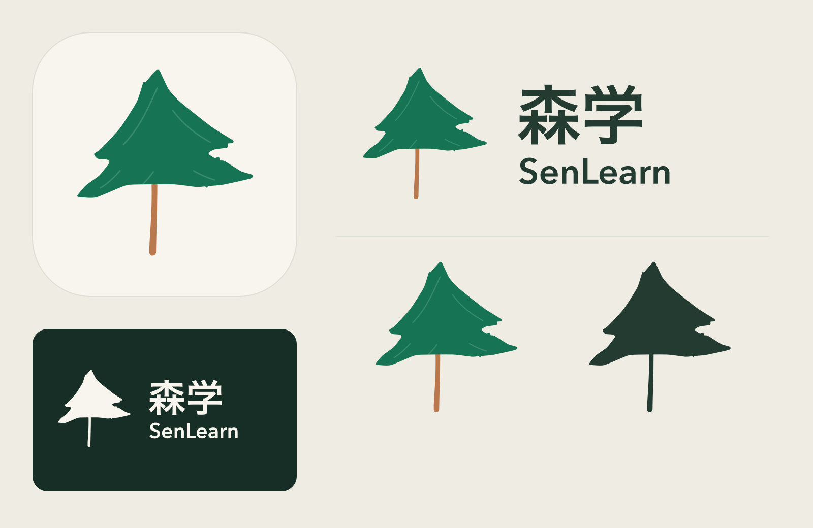

# 森学 · 从女儿的小树开始

2026-10-11 · 图标与品牌 logo 第一版

这棵树来自项目作者女儿的原画。森学的「森」来自妈妈的名字，小树来自女儿的画，父亲将它做成一家人共同使用的点读 app。设计保留原画的两层不对称树冠、略偏左的树尖、绿色树冠和细棕色树干，以暖纸色呼应现有「森间书桌」主题。

## 制作方式

对原画绿色树冠进行颜色分离、轮廓提取与曲线简化，而后做排版和矢量精修。树干缩短以提高桌面图标的识别度；五条轻量矢量笔触延续蜡笔的方向感。没有加入书本、耳机或其他图形，避免掩盖孩子画的树。

本版采用源图轮廓转矢量与确定性排版，没有调用 AI 位图生成。所有交付 SVG 都由真实路径组成，无内嵌 PNG、外部字体、网络资源或脚本。中文「森学」和英文「SenLearn」已转换为轮廓，跨设备不依赖字体。需要改字时用 `tools/outline-wordmark.swift` 重新生成轮廓。

## 文件

| 文件 | 用途 |
| --- | --- |
| `svg/senlearn-app-icon.svg` | 1024 × 1024 方形、不透明 app 图标母版 |
| `svg/senlearn-app-icon-dark.svg` | 深色桌面图标母版 |
| `svg/senlearn-logo-horizontal.svg` | 透明背景，中英双语横版 logo |
| `svg/senlearn-logo-stacked.svg` | 透明背景，中英双语竖版 logo |
| `svg/senlearn-mark.svg` | 透明背景，独立小树标志 |
| `svg/senlearn-mark-small.svg` | 去除细笔触的简化小尺寸标志 |
| `svg/senlearn-logo-monochrome.svg` | 深森林绿单色 logo，适合印刷 |
| `svg/senlearn-mark-monochrome.svg` | 单色小树标志 |
| `svg/senlearn-logo-reverse.svg` | 暖白反白 logo，配深色背景使用 |
| `svg/daughter-tree-trace.svg` | 保留原画长树干的轮廓存档，不作为默认图标 |
| `png/` | 对应的 2 倍 PNG，以及 1024 / 512 / 180 / 120 / 60 / 40 / 32 px 图标 |
| `source/` | 原画预览及字标轮廓数据，原始 HEIC 留在上级 docs 目录 |
| `manifest.json` | 原画摘要、颜色、字体、处理路线和 SVG 文件校验值 |

## 应用接入

默认与深色 1024 px PNG 已放入 `SenLearn/Resources/Assets.xcassets/AppIcon.appiconset/`，应用 Debug / Release 均指定 `AppIcon`。工程生成脚本也保留该设置。图标母版为满底方形，圆角由系统处理；预览页中的圆角仅用于展示。

横版 logo 建议宽度不低于 160 px。小于 64 px 的独立图形优先使用 `senlearn-mark-small.svg`。单色印刷优先使用单色版，不依赖浅色细笔触。反白版必须放在深色背景上。外部留白建议至少为标志宽度的 1/8；保持原始比例，避免拉伸、追加外描边或将照片背景带入标志。

| 色彩 | HEX |
| --- | --- |
| 小树绿 | `#167454` |
| 树干棕 | `#B9784D` |
| 暖纸白 | `#F7F5ED` |
| 字标墨绿 | `#243B32` |
| 深色背景 | `#172E26` |

中文轮廓来源为 macOS HiraginoSansGB-W6，英文为 AvenirNext-DemiBold；SVG 中已固化为路径。源字体文件没有随包分发。

## 再生成

1. macOS 执行 `swift docs/brand/tools/outline-wordmark.swift docs/brand/source/wordmark-outlines.json`。
2. 使用装有 Pillow / numpy 的 Python 执行 `docs/brand/tools/build_brand.py`。
3. 使用装有 sharp 的 Node.js 执行 `docs/brand/tools/render.cjs`。
4. 将 `png/senlearn-app-icon-1024.png` 和 `png/senlearn-app-icon-dark-1024.png` 复制到 AppIcon 资源中对应的文件名。

Creative Production 画板：`a66d5431-c5ef-4f11-966e-01629342d41f`。
