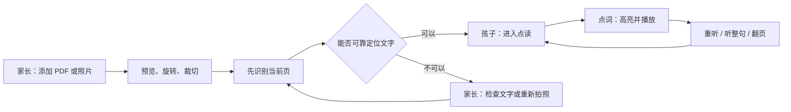

# SenLearn · UI / UE 方案

2026-10-09 · 面向儿童学习、家长陪伴

依据：`docs/DesignConcept.md` 与本次沟通。当前仓库包含产品概念、视觉稿与静态交互原型，尚无 iOS / iPadOS 应用工程或真实 OCR / 本地 TTS 集成。四张原始视觉稿统一使用虚构的原创示例读物 **Forest Friends** 和同一个点读场景，方便比较布局与体验。图片用于视觉定调，准确文案与交互以本文为准。

## 方向选择

| 方案 | 视觉语言 | 主要交互 | 更适合 | 取舍 |
| --- | --- | --- | --- | --- |
| A · 森间书桌 | 纸白、森林绿、淡鼠尾草；温暖的书桌感 | 点词即发音，词旁轻量浮层；播放条常驻 | 日常自主点读与亲子共读 | 装饰要克制，不能盖住原始教材 |
| B · 清透原生 | 浅灰、白、系统蓝；清晰的分栏与工具层级 | 原文、页缩略图、辅助面板并置 | 家长准备材料、纠错、陪读 | 三栏信息较多，孩子独读时应折叠两侧 |
| C · 探索乐园 | 奶油黄、珊瑚红、天蓝；大圆角和明确反馈 | 听单词、听整句、再听一次三种大按钮；轻量探索反馈 | 低龄孩子、首次学习点读 | 避免角色、奖励和动画抢走阅读注意力 |
| D · 月光共读 | 深墨蓝、温润纸色、低饱和薄荷；安静聚焦 | 收起侧栏、单句聚焦、明显重听与暂停 | 晚间亲子共读、需要更少界面刺激的场景 | 深色外壳不等于护眼；原始 PDF 不宜强制反色 |

**已确认主线：A 的品牌气质 + C 的大触控与即时反馈。** 默认主题叫「森间书桌」，B / C / D 保留为设置中的其他主题；四张原始概念稿完整保留。所有主题共用大按钮和相同操作位置。家长辅助分栏与阅读聚焦属于独立布局选项，不由主题强制切换。

## 已确认的主题设置

入口为「设置 → 外观主题」。主题页展示带简洁缩略预览和名称的单选卡，当前主题同时有选中边框、勾选标记与可访问选中状态。

| 稳定标识 | 设置中名称 | 主题范围 |
| --- | --- | --- |
| `forest` | 森间书桌 · 默认 | A 的纸白、森林绿、淡鼠尾草，配合 C 的三项大按钮 |
| `native` | 清透原生 | 浅灰、白与蓝，更克制的圆角和界面装饰 |
| `play` | 探索乐园 | 奶油黄、珊瑚红、天蓝与柔和的大圆角 |
| `night` | 月光共读 | 深墨蓝外壳、薄荷色操作区，教材保持原色 |

选择即应用并保存在本机，无额外保存按钮。首次启动默认 `forest`，再次启动恢复上次选择；无效或过期的主题值回退到 `forest`。关闭设置只返回阅读，不撤销已选择的主题；「恢复默认主题」只改主题，不重置其他设置。

主题只控制应用颜色、圆角和少量装饰，不改变当前页码、选中词句、阅读位置、语速、播放状态、教材内容或已校对文字。切换过程中不自动出声，不重启页面。减弱动态效果单独设置，并尊重系统减少动态效果偏好。

儿童核心操作在四种主题下始终保持「听单词」「听整句」「再听一次」的名称、顺序和大触控区域；播放过程中有明确的停止或暂停入口。家长辅助模式不因选择清透原生而自动展开，聚焦模式也不因选择月光共读而自动开启。

设置用可关闭的对话框或抽屉承载，窄屏完整显示。键盘焦点留在打开的设置中，关闭后回到设置按钮。若设备无法保存偏好，当前页面仍能使用主题，并提示关闭页面后可能不会保留。

交互原型见 `prototype/index.html`：可切换四种主题、刷新恢复、选词、翻页、调整语速和打开关闭设置。试听仅使用浏览器可提供的本机英文声音；没有可用本机声音时明确提示，不调用外部语音服务。它不表示生产版离线语音引擎已实现。

## 共同信息架构

```text
书架
├─ 继续阅读：最近一本、上次页码
├─ 我的材料：封面 + 书名；点击直接继续点读
├─ 家长辅助
│  ├─ 添加材料：拍照 / 选照片 / 导入 PDF
│  ├─ 检查文字：原图与识别结果对照、纠错、重试
│  └─ 管理材料：重命名、移除、存储空间
└─ 设置
   ├─ 外观主题：森间书桌 / 清透原生 / 探索乐园 / 月光共读
   └─ 阅读偏好：语言、声音、语速、减少动态效果

阅读页
├─ 点读：点单词、听整句、听整页、暂停 / 重听
├─ 翻页：上一页 / 下一页、页码
├─ 小词卡：发音、已具备本地内容时显示释义
├─ 设置：与书架共用外观主题和阅读偏好
└─ 更多：家长辅助、标注模式（后续）
```

孩子默认进入上次的阅读场景。书架不放学习排名、连续签到和复杂数据图表。家长入口有清楚的文字标签，不要求孩子通过隐蔽手势才能离开或暂停。

## 核心流程与界面状态



| 场景 | 画面与操作 | 反馈与恢复 |
| --- | --- | --- |
| 首次打开 | 一张空书架卡片，主按钮「添加第一份材料」；三个来源在下一层展开 | 不要求登录；说明「材料保存在这台设备」 |
| 照片预览 | 大预览、旋转、裁切、「开始识别」 | 模糊时给出可执行提示「把页面拍清楚一些」，保留原图 |
| PDF 导入 | 文件名、总页数、当前页缩略图 | 优先准备当前页；当前页就绪后可阅读，剩余页继续处理 |
| 识别中 | 页面仍可见，显示真实阶段「正在识别第 3 页」 | 不编造百分比或剩余时间；可返回、取消、稍后继续 |
| 准备好 | 一次性短提示「点一点文字，听听怎么读」 | 不自动播放整页；首次点词后提示消失 |
| 点词播放 | 原位置高亮，词卡避开文字，播放按钮有暂停状态 | 切换词时停止旧音频，只播放最后一次明确选择 |
| 密集小字 | 点击存在歧义时出现局部放大条，提供较大的候选词 | 不让相邻文字各自盲目扩张而产生重叠命中区域 |
| 跟读 | 听完一句后可停留，由孩子口头跟读；「再听一次」始终可见 | 首版不依赖麦克风、不做自动评分；录音回放另行评估 |
| 文字识别有误 | 家长点击「检查文字」，对照原图编辑 | 仅修改识别层，不破坏原文件；支持撤销并重建对应音频。词数或断句变化时重新确认文字框映射；定位恢复前暂停该区域逐词点读 |
| 无法识别 | 显示原页和「重新拍照」「选择文字区域」 | 不生成假的可点击词块；其他已就绪页继续可用 |
| 声音未就绪 | 当前词仍高亮；文字提示「正在准备声音」或「此声音暂不可用」 | 可切换设备上已就绪的声音；不显示虚假的播放进度 |
| 翻页或离开 | 停止旧页音频，保留阅读页码与已校对内容 | 再打开回到原位置，但不自动出声 |
| 移除材料 | 家长层显示文件名与确认按钮 | 若实现最近删除，可提供恢复；否则清楚说明后果 |

## 原始四版 UE 探索

以下保留原始探索思路。定稿以「已确认的主题设置」为准，布局与能力不再绑定某一种主题。

### A · 森间书桌

- 打开材料后，书页位于中央，阅读工具贴近底部；页缩略图可收起。
- 点词直接发音，小词卡显示「再听一次」与「听整句」，不把每次点词变成一次弹窗确认。
- 发音结束后保留淡色选中状态，方便家长指着同一个词解释。
- 趣味反馈采用局部轻微变化，例如一个小叶片亮起；不累计排行榜分数。
- 适合作为默认方案。视觉稿里的侧栏在儿童模式默认收起。

### B · 清透原生

- 家长陪读时展开页缩略图和辅助面板，原图不被浮层盖住。
- 辅助面板展示选中词和播放操作；「检查文字」进入独立纠错状态，再开放编辑。
- 一键「专心读」收起两侧，孩子只看到书页、翻页与声音控件。
- 语速、语言与声音的更改放入家长层，避免误触连续改变发音设置。

### C · 探索乐园

- 初次进入提示「点一点，听一听」，只示范一个词，不连续教学五六个步骤。
- 听单词、听整句、再听一次用大按钮表达；当前对象始终与书页选区对应。
- 可用少量叶片表现“刚刚探索过”，不设置限时、失败惩罚或连续打卡损失。
- 小角色只在首次提示和完成一次操作时短暂回应，播放过程中保持安静。
- 动画和音效可关闭，语音优先，避免反馈音盖住发音。

### D · 月光共读

- 默认收起材料导航，保留原页或单句聚焦区域；工具数量最少。
- 选择一句后，家长可播放、暂停、重听，再手动切换下一句；不默认无限连播。
- 深色主题只改变应用外壳。扫描原页保持原色，避免图表、彩色注释被反色破坏。
- 若提供重排文字模式，应让用户随时返回原页，明确两者的对应关系。
- 不以“护眼”“改善睡眠”等未验证效果作为产品文案。

## 视觉基础与组件规范

以下为落地起点，具体对比度和排版需在真机逐项验收。

| Token | A 森间书桌 | B 清透原生 | C 探索乐园 | D 月光共读 |
| --- | --- | --- | --- | --- |
| 应用背景 | `#F7F5ED` | `#F3F5F8` | `#FFF8E8` | `#17262D` |
| 主操作色 | `#2C6250` | `#2563EB` | `#9E3F2C` | `#B6DCCE` |
| 装饰 / 选中底色 | `#DCE8DC` | `#E3EDFF` | `#F5C75A` | `#35594F` |
| 应用界面文字色 | `#243B32` | `#202833` | `#423426` | `#E8EDE7` |
| 卡片圆角建议 | 20 pt | 14 pt | 24 pt | 18 pt |

- 教材页与重排文字使用独立配色，不继承月光主题的浅色界面文字。示例教材采用暖白 `#FFFDF7` 底、深色 `#243B32` 字，选词底色与文字也独立配对；原始图片 / PDF 的颜色保持不变。
- 系统中文字体与清晰的英文阅读字体。工具文字建议 17–20 pt；重排模式的学习句子建议从 26–32 pt 起，支持调大。原始扫描页通过缩放阅读，不伪装成可无损放大的文字。
- 控件触控区域基线采用至少 44 × 44 pt；儿童主要操作建议 56 × 56 pt 或更大。后者是本项目建议值。参考 [Apple UI Design Dos and Don’ts](https://developer.apple.com/design/tips/)。
- 页面一般留白以 8 pt 为节奏，主区域建议 24–32 pt 间距；不要靠近系统返回手势或遮住安全区。
- 播放、暂停、已选中同时使用图标 / 文字 / 状态变化表达，不能只靠颜色。
- 词卡优先出现在选区下方空白；空间不足时改为底部面板。不要遮住正在发音的单词或下一句。
- 支持系统字体缩放、VoiceOver 操作标签和减少动态效果。相关基线参考 [Apple Accessibility](https://developer.apple.com/design/human-interface-guidelines/accessibility) 与 [Apple Motion](https://developer.apple.com/design/human-interface-guidelines/motion)。
- 没有可靠单词时间戳时按句高亮，不用装饰性动画假装实现逐词语音对齐。

## iPad / iPhone 适配

| 空间 | 建议布局 |
| --- | --- |
| 宽 iPad 横屏 | 原页居中；儿童模式默认收起两侧；家长辅助状态可同时展开缩略图与辅助面板 |
| iPad 竖屏或较窄窗口 | 原页 + 底部控制；目录以抽屉打开，词卡避免挤压正文 |
| iPhone | 单栏阅读；底部保持播放 / 暂停与翻页；词详情用可关闭底部面板 |
| 大字体或辅助功能布局 | 操作换行而非缩小文字；工具组可滚动；确保焦点顺序从书名到正文到播放控制 |

布局按实际可用宽度切换，而不是只判断设备名称。手指点读与手写标注明确分模式；Apple Pencil 标注需显示当前模式，避免点读和画线同时触发。

## 建议开发顺序

**首版：** 本地材料书架、PDF / 照片导入、识别状态、点词发音、听整句 / 听整页、重听 / 暂停、语速、页码恢复、家长纠错、基本声音可用性提示，以及四种主题的选择与本地保存。首版交付应具备无需联网即可使用的基础中英声音；额外声音未就绪时，不把它设为孩子的默认声音。

**第二阶段：** 手写标注、本地词卡收藏、可关闭的轻量趣味反馈与跟读录音回放。

**后续验证：** 自动总结、知识扩展、个性化动画、声音复刻。只有本地内容或模型实际支持时才出现对应入口；不将联网生成能力混进“完全离线”的默认承诺。

## 验收任务

用真实 iPad 和几份实际教材做小规模观察，不预设测试结果：

1. 孩子在没有口头教学时找到并完成一次点读；记录是否找得到暂停与重听。
2. 家长导入一页倾斜、光线不均的照片，能发现并修正识别错误。
3. 密集英文段落连续点击不同词，选中对象和播放内容一致，旧声音不排队。
4. 翻页、旋转设备、切换后台再返回后，页码、选区与播放状态一致。
5. 断网首次启动和重启后，基础中英发音可用；已导入材料可打开。切换到缺失或损坏的额外声音时，家长能回到可用基础声音，孩子能看到明确状态。
6. 系统大字体、VoiceOver、减少动态效果开启后，核心操作仍可完成。
7. 在不同页码与选词下依次切换四种主题，阅读状态、语速与当前播放不变；刷新后恢复主题，恢复默认只影响主题。检查月光主题不会反色原始教材。

## 交付说明

- 四张 PNG：高保真概念视觉稿，未连接 OCR / TTS，不代表可运行 App。
- `prototype/`：融合方案与主题设置的可操作静态原型，包含主题持久化与本机声音试听降级处理；没有真实材料导入和识别能力。
- `assets/forest-lesson.png`：各主题共用的原创示例插画，使用内置 ImageGen；完整提示词保存在同目录。
- `review-board.html`：由 Creative Production 官方 review renderer 生成的本地对比页，可放大查看。
- `manifest.json`：视觉方向、生成路线、提示词与文件映射。
- 各 `*-prompt.txt`：实际使用的完整生成提示词，采用内置 ImageGen。
- Creative Production board：`f6433cae-2f6f-4eda-a93a-3128c92a4c1c`，后续可沿用这一块画板继续细化。
